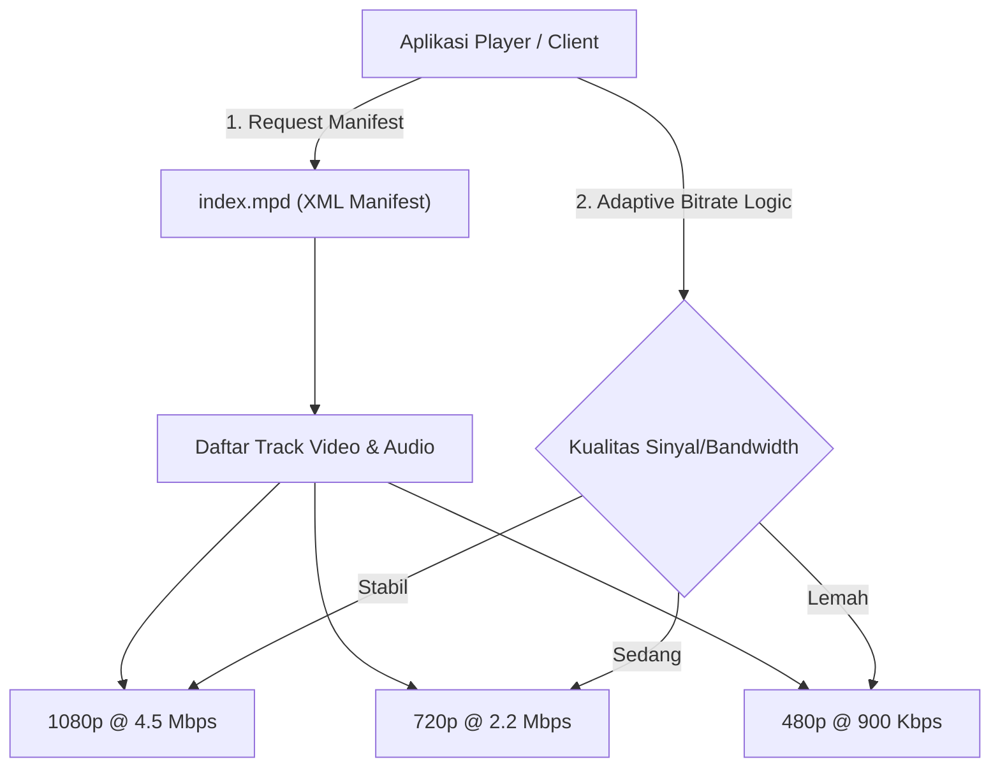
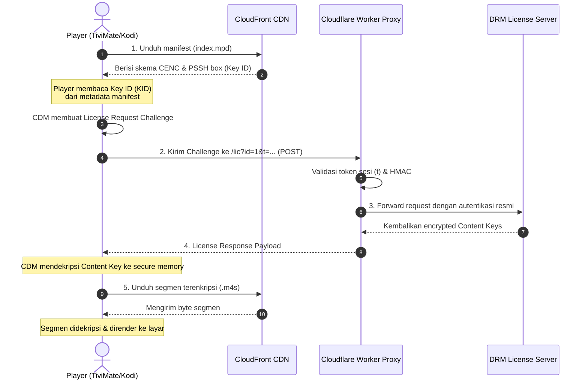

# Studi Kasus Arsitektur Streaming IPTV, MPEG-DASH & Widevine DRM

Dokumen ini merangkum analisis teknis dan pembelajaran arsitektural dari playlist streaming IPTV modern berbasis MPEG-DASH dan Widevine DRM (studi kasus: [visionplus.m3u](file:///d:/TOPIK%202/visionplus.m3u)).

---

## 1. Anatomi Struktur Playlist M3U Modern

Format file M3U bukan sekadar daftar teks tautan URL, melainkan protokol instruksi pemutaran multimedia yang kaya akan metadata.

```m3u
#EXTM3U url-tvg="https://bit.ly/IndonesiaEpg"
#EXTINF:-1 tvg-id="RCTI" tvg-logo="https://.../507720-LOGO-m.png" group-title="Nasional",RCTI
#KODIPROP:inputstream.adaptive.license_type=com.widevine.alpha
#KODIPROP:inputstream.adaptive.license_key=https://visionplus.drmiontv.workers.dev/lic?id=1&t=YXV0by...
#EXTVLCOPT:http-referrer=https://www.visionplus.id/
#EXTVLCOPT:http-origin=https://www.visionplus.id/
#EXTVLCOPT:http-user-agent=Mozilla/5.0 (Windows NT 10.0; Win64; x64) AppleWebKit/537.36 ...
https://d2xz2v5wuvgur6.cloudfront.net/out/v1/997ce8767b604fae9fce05379b3b8b3a/index.mpd
```

### Penjelasan Elemen Tag:

| Tag / Directive | Deskripsi & Fungsi Teknis |
| :--- | :--- |
| `#EXTM3U url-tvg="..."` | Header standar M3U extended. Atribut `url-tvg` mengarahkan player ke file **XMLTV (EPG)** untuk menampilkan jadwal siaran TV secara real-time. |
| `#EXTINF:-1 ...` | Menentukan durasi streaming (`-1` berarti siaran langsung/live stream) beserta metadata channel. |
| `tvg-id="..."` | ID unik channel yang dicocokkan dengan entitas channel di dalam database EPG. |
| `tvg-logo="..."` | URL gambar/ikon resolusi tinggi untuk antarmuka pengguna (UI) player. |
| `group-title="..."` | Tag klasifikasi/kategori (misal: *Nasional*, *Sports*, *Movies*) untuk memudahkan navigasi folder di player. |
| `#KODIPROP:...` | Properti khusus untuk modul pemutar adaptif (seperti Kodi **InputStream Adaptive**, TiviMate, OTT Navigator). Digunakan untuk konfigurasi DRM. |
| `#EXTVLCOPT:...` | Opsi khusus modul VLC/ExoPlayer untuk menyuntikkan header HTTP kustom saat melakukan request segmen video. |

---

## 2. Protokol Streaming: MPEG-DASH (`.mpd`) vs HLS (`.m3u8`)

Playlist ini menggunakan format **MPEG-DASH** (*Dynamic Adaptive Streaming over HTTP*):



### Mengapa Industri Menggunakan MPEG-DASH untuk Konten Terproteksi?
1. **Standar Terbuka ISO/IEC**: DASH adalah standar industri agnostik (tidak terikat vendor tertentu seperti HLS yang diciptakan Apple).
2. **CENC (*Common Encryption Scheme*)**: Mendukung enkripsi tunggal (misal AES-128 CTR) yang dapat didekripsi oleh berbagai sistem DRM (Widevine di Android/Chrome, PlayReady di Windows/Edge) tanpa perlu membuat file video ganda.
3. **Struktur File MP4 Terfragmentasi (fMP4)**: Video dipecah menjadi segmen kecil (2–6 detik) yang mempermudah *caching* di CDN edge.

---

## 3. Arsitektur Enkripsi & DRM (Google Widevine)

Konten dilindungi dengan **Google Widevine Modular** (`com.widevine.alpha`).

### Alur Kerja Handshake Lisensi Widevine:



### Istilah Penting DRM:
* **CDM (*Content Decryption Module*)**: Modul internal sistem operasi (Android L1/L3 hardware, Chrome CDM) yang bertugas menjaga kunci enkripsi di memori aman.
* **PSSH (*Protection System Specific Header*)**: Blok biner di dalam manifest MPD yang berisi UUID DRM (untuk Widevine: `edef8ba9-79d6-4ace-a3c8-27dcd51d21ed`) dan ID Kunci (KID).
* **ClearKey vs Widevine**: Berbeda dengan ClearKey di mana kunci dikirim berupa teks heksadesimal polos (KID:KEY), Widevine memerlukan pertukaran pesan kriptografis terenkripsi (*handshake challenge-response*).

---

## 4. Keamanan Jaringan & Anti-Hotlinking (`#EXTVLCOPT`)

Pada playlist terdapat instruksi header:
```m3u
#EXTVLCOPT:http-referrer=https://www.visionplus.id/
#EXTVLCOPT:http-origin=https://www.visionplus.id/
#EXTVLCOPT:http-user-agent=Mozilla/5.0 ...
```

### Mengapa Header Ini Wajib?
1. **Validasi Origin & CORS**: CDN CloudFront dan Origin Server memeriksa header `Origin` dan `Referer`. Jika sebuah permintaan dikirim tanpa header tersebut, CDN menganggapnya sebagai *unauthorized hotlinking* dan merespons dengan **HTTP 403 Forbidden**.
2. **User-Agent Filtering**: Beberapa stream membatasi request hanya untuk User-Agent peramban resmi desktop/mobile untuk mencegah bot scraping otomatis.

---

## 5. Peran Edge Computing (Cloudflare Workers)

Domain lisensi `visionplus.drmiontv.workers.dev` memanfaatkan **Cloudflare Workers**:

```text
https://visionplus.drmiontv.workers.dev/lic?id=1&t=YXV0by0xMDY2Yj...
```

* **Token Format (Base64)**:
  ```text
  Base64: YXV0by0xMDY2YjQ4MjI0YmIxODhjfDE3OTI0MjkyMjd8MjYwYzAyNzVi...
  Decoded: auto-1066b48224bb188c | 1792429227 | 260c0275b4cd92951e53307ea6c022603d1a01f84c47e1f45ac75bcbe532901c
           [    Device/Session  ]   [ Timestamp ]   [                      HMAC Signature                   ]
  ```
* **Fungsi Edge Worker**:
  1. Menerima *license request* dari player pengguna di seluruh dunia dengan latensi sangat rendah (Anycast routing Cloudflare).
  2. Memverifikasi apakah masa berlaku token sesi (`timestamp`) masih aktif.
  3. Bertindak sebagai *Reverse Proxy* yang menyuntikkan kredensial resmi ke server lisensi penyedia konten tanpa mengekspos token internal kepada publik.

---

## 6. Distribusi Konten Skala Besar (CDN)

Semua video dilayani melalui Amazon CloudFront:
* URL contoh: `https://d2xz2v5wuvgur6.cloudfront.net/out/v1/997ce8767b604fae9fce05379b3b8b3a/index.mpd`
* **Edge Caching**: Setiap segmen video berdurasi beberapa detik disimpan di ratusan titik PoP (*Point of Presence*) CloudFront terdekat dari ISP penonton.
* **Origin Offloading**: Server utama transmisi TV hanya perlu menyalurkan satu feed ke CloudFront; CloudFront yang mereplikasi segmen tersebut ke jutaan pemirsa secara bersamaan.

---

## 7. Matriks Kompatibilitas Pemutar

| Pemutar / Platform | Dukungan DASH | Dukungan Widevine | Catatan Penggunaan |
| :--- | :---: | :---: | :--- |
| **TiviMate (Android TV)** | ✅ | ✅ | Mendukung pemutaran native jika perangkat Android memiliki modul Widevine (L1/L3). |
| **OTT Navigator (Android)** | ✅ | ✅ | Membaca tag `#KODIPROP` dan parameter lisensi secara otomatis. |
| **Kodi (Multi-platform)** | ✅ | ✅ | Wajib mengaktifkan add-on **InputStream Adaptive**. |
| **ExoPlayer (Android Dev)** | ✅ | ✅ | Menggunakan `MediaItem.DrmConfiguration.Builder(C.WIDEVINE_UUID)`. |
| **VLC Player Standar** | ⚠️ Terbatas | ❌ | VLC standar desktop tidak menyertakan modul Widevine CDM karena batasan lisensi kepemilikan Google. |
